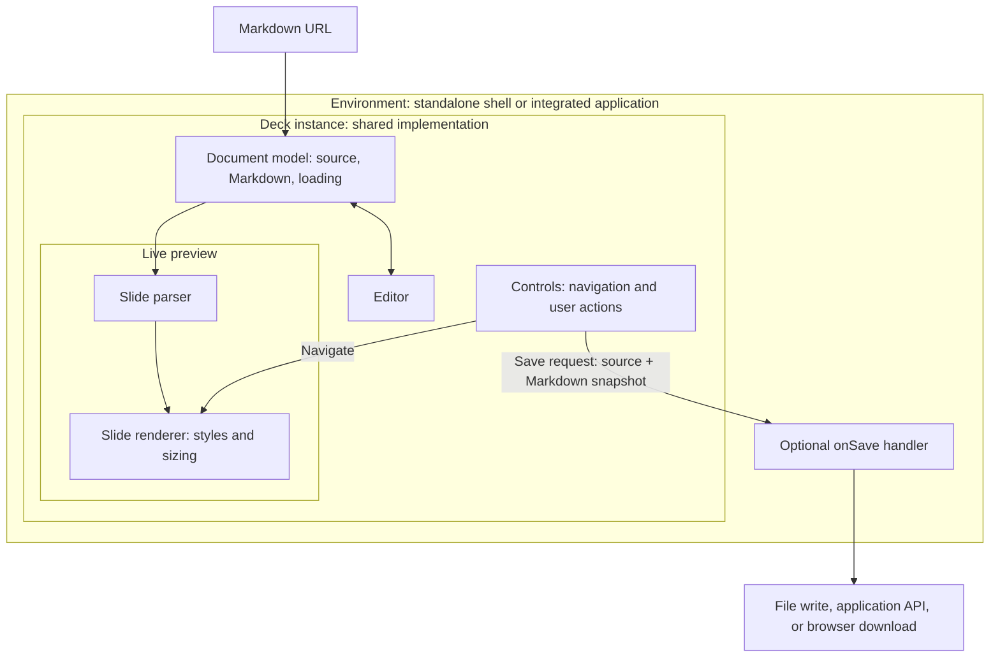
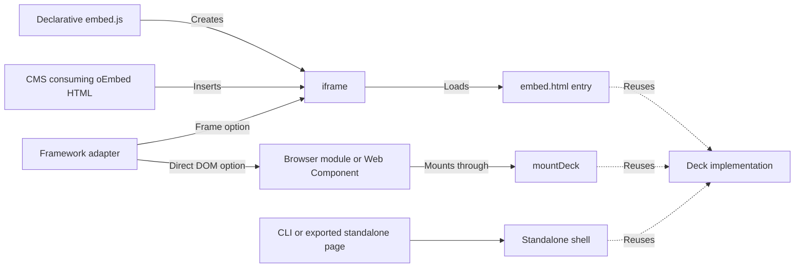
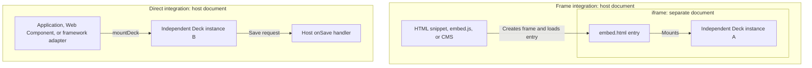

# Embedding Markdown decks

Status: first implementation completed on 2026-10-26. The shared Deck boundary,
standalone persistence adapters, and iframe entry are implemented. Browser module,
Web Component, declarative loader, framework, and oEmbed adapters remain future
options. Example browser-module exports below are proposals, not published APIs.

## Context and confirmed requirements

Eloc should render a Markdown URL as a presentation inside another page. YouTube
players and Twitter embeds illustrate possible integrations; neither determines
the component's appearance or transport.

The embedded experience must support an editor and live preview. General external
control of navigation, content, or playback is not currently required. Save is an
outgoing request: the environment decides how to persist the current Markdown.
A plain embed can omit persistence entirely. Existing CLI saves, static-site
downloads, source identity checks, and failed-read recovery must remain available
in their existing environments.

Behavior before this refactor:

- `src/client/document.ts` resolved `?src=`, loaded Markdown, held editing state,
  and either wrote through `/api/save` or downloaded a Blob. Omitting a save token
  selected downloads; it did not disable saving.
- `src/client/app.tsx` combined presentation UI, document loading, window
  shortcuts, hash navigation, and save feedback.
- `src/client/app.css` hid the slide column while editing below 960px. An embed
  at that width lost the visible live preview.
- `src/client/slide.tsx` already sized slides with a `ResizeObserver` and isolated
  slide styles in shadow roots. All author HTML was trusted.
- `scripts/build.mjs` built a single browser entry embedded into the CLI.
  This build structure remains; the npm package still publishes the CLI.

## Ownership and data flow

The implemented boundary is an editable deck with an optional save-request handler:



Boxes show containment; arrows show data or requests. The save handler belongs
to the environment, outside the reusable Deck. A passive iframe omits it.

The document model owns resolved source identity, loading outcome, Markdown, and
the effective resource base URL. The deck owns editing, slide parsing, selection,
navigation, rendering, and user actions. It does not own a filesystem path,
save token, write endpoint, download implementation, or persistence fallback.

The environment chooses whether to install a save handler. That handler owns
authorization, the destination, and the persistence operation. A request's source
is context, not authority to choose a writable file or arbitrary endpoint.

## Internal component and future browser contract

`src/client/deck.tsx` implements the shared component. Its internal props accept a
document model and an optional `onSave(request): Promise<void>` handler, along with
initial view, theme, and shell integration settings. `src/client/app.tsx` selects
the standalone or embed environment; `src/client/persistence.ts` owns local-save
authorization and download execution. The document model performs neither writes
nor downloads and does not read host URL query parameters.

For a future published browser module, the planned initialization API remains:

```ts
interface SaveRequest {
  markdown: string
  source: string
}

interface DeckOptions {
  src: string
  view?: 'present' | 'edit'
  theme?: 'light' | 'dark'
  onSave?: (request: SaveRequest) => Promise<void>
}

declare function mountDeck(
  container: HTMLElement,
  options: DeckOptions
): () => void
```

`source` is the absolute, normalized requested document URL, with its fragment
removed. A redirect's final URL supplies the resource base but does not silently
change the environment's authorized write destination.

`mountDeck` is an initialization API; its return value only disposes the instance.
It does not expose navigation or content-control methods. The name `eloc/player`
below is a proposed browser-only package export, not the current Node CLI entry.

```ts
import { mountDeck } from 'eloc/player'

const dispose = mountDeck(document.querySelector('#demo')!, {
  src: '/examples/intro.md',
  view: 'edit',
  onSave: async ({ markdown }) => {
    const response = await fetch('/api/drafts/intro', {
      method: 'PUT',
      headers: { 'Content-Type': 'text/markdown; charset=utf-8' },
      body: markdown
    })
    if (!response.ok) throw new Error('Unable to save draft')
  }
})
```

The destination above is chosen by the application; it is not derived from
event content. Omitting `onSave` creates an editor and preview without a Save or
Download action. No `saveUrl`, `saveToken`, or `saveMethod` belongs in this API.

Save semantics:

- Save and Cmd/Ctrl+S use the same request path and capture the Markdown at that
  moment. Only one save request is active per instance.
- The optional handler makes the Save action available. While it is pending,
  show saving feedback; resolution confirms completion and rejection reports
  failure while retaining the editor contents. Emission alone is not success.
- Editing can continue while a request is pending. Completing that request must
  not replace newer editor text or claim that newer text was saved.
- Without a handler, save gestures perform no persistence and never fall back
  to a download. Prevent the browser's save-page shortcut only while focus is
  inside the deck. This is application behavior, not a restriction on what users
  can copy or save through their browser.
- No autosave or reload persistence is introduced. A passive embed's edits live
  in memory until its frame or component is reloaded or removed.

This callback expresses the outgoing event within one JavaScript environment.
A DOM-event wrapper or iframe bridge can translate that same intention when
those integration forms are needed; they do not create new persistence owners.

## Integration options

| Form | Integration | Strength and cost | Suggested order |
| --- | --- | --- | --- |
| Hosted or self-hosted iframe | HTML containing an `embed.html` URL | Independent document, styles, keyboard context, and hash. Low host coupling; fixed host-controlled dimensions. | First public integration |
| Declarative embed script | A placeholder and `embed.js`, which inserts the same iframe | Easier snippets, fallback links, lazy loading, and consistent sizing. Adds a small loader, not another renderer. | Add for snippet convenience |
| Browser module / native Web Component | `mountDeck(...)` or an optional `<eloc-deck>` wrapper | Direct `onSave` integration and host-origin loading. Requires instance-scoped styles, shortcuts, lifecycle, and an explicit HTML trust policy. | Add when applications need direct integration |
| Framework adapter | React, Vue, or Solid wrapper around an iframe or the browser module | Familiar props and teardown for a chosen ecosystem. It should reuse the same renderer and save contract. | Demand-driven |
| oEmbed | A participating CMS turns a presentation-page URL into embed HTML | Improves link-paste workflows. Requires a provider endpoint, discovery, and consumer support; it is not a new player runtime. | After a CMS integration is needed |

There are two execution models here: an isolated frame and rendering in the
host document. Script snippets, framework wrappers, and oEmbed are integration
layers around them. The first implementation extracts the reusable deck boundary
and supplies the iframe entry. The other wrappers remain demand-driven.

### Implementation reuse

This diagram shows how integration layers reuse implementation. A shared node
does not mean shared runtime state: each mount creates its own Deck instance.
The standalone shell, Deck, and `embed.html` are implemented. The other wrappers
in this diagram remain proposed interfaces.



The framework adapter chooses an existing execution model. Neither it nor the
declarative loader or oEmbed provider owns another editor or renderer.

### Runtime containment

The two execution models have different document boundaries. The implemented
iframe entry has no save handler and needs no message bridge. The direct-DOM
integration shown for comparison is a future option; its requests would reach the
host handler within the same JavaScript environment.



The containment of the editor, preview, and document state inside either Deck
instance is the same as in the ownership diagram above. The standalone shell
uses that same boundary with its CLI-save or browser-download adapter.

## Iframe API

Use a static-friendly entry rather than requiring a server-side player API:

```html
<iframe
  src="https://player.example/embed.html?src=https%3A%2F%2Fcdn.example%2Fintro.md&amp;view=edit"
  title="Editable presentation example"
  loading="lazy"
  style="display:block;width:100%;height:480px;border:0"
></iframe>
```

| Parameter | Values | Default |
| --- | --- | --- |
| `src` | A raw Markdown URL; required for the generic embed entry | None |
| `view` | `edit` or `present` | `edit` |
| `theme` | `light` or `dark` | `light` |

These are initialization settings. `edit` displays the editor and live preview;
`present` initially collapses the editor, which remains available through Edit.
Invalid non-source options fall back to their defaults; a missing or invalid
source produces a visible loading error and an editable empty document.

Use absolute source URLs in published snippets. Relative iframe `src` parameters
resolve against the embed entry, whereas a module or script wrapper normalizes
relative inputs against the host document before mounting or constructing a URL.
Build query strings with `URL` and `URLSearchParams` so source query parameters,
percent signs, and fragments are encoded correctly.

Width and height belong to the outer iframe's CSS, not the content query API.
The deck fills its container. In edit view, use columns when space permits and
stack editor and preview in narrow frames; do not hide preview merely because
the embed is narrower than 960px. Initial mounting must not steal host-page focus.
Keep navigation and shortcuts within the active frame or component.

The plain iframe installs no save handler. It offers editing and preview without
saving. Supplying a query parameter cannot grant access to the CLI save adapter.

If iframe saving later becomes useful, introduce only a save-request bridge:
correlated request and result messages carrying the same Markdown snapshot. The
bridge must validate `event.origin` and `event.source`, use an exact target origin,
and handle host failure or removal. This acknowledgment is save completion, not
a general remote-control API. It is unnecessary for the first passive iframe.

## Environment save adapters

| Environment | Handler behavior |
| --- | --- |
| CLI presentation | Write through the existing token-protected endpoint only for the configured document after a successful read or an explicit confirmed-missing response. |
| CLI source override or failed read | Preserve the current recovery/download behavior; never write an alternate or unreadable document over the configured source. |
| Exported standalone page | Download the current Markdown under the displayed document's filename. |
| Plain embedded page | Install no handler; no writes or downloads. |
| Integrated application | Supply a handler for its own API, storage, download, or other persistence operation. |

The standalone shell retains the existing Save/Download labels through its own
adapter configuration. The reusable deck should not infer a download action from
the absence of a local save token. Keeping the existing canonical-source and
failed-read checks is essential during this extraction.

## Loading and content compatibility

An iframe does not bypass CORS. If `embed.html` fetches a different origin's
Markdown, that origin must permit the player origin to read it. Start with public
HTTPS sources and ordinary browser fetching; do not require cross-site cookies
or build an arbitrary-URL proxy for the first version. Self-hosting the player
alongside the Markdown is another deployment of the same interface.

Remote content uses the final response URL as its resource base, so images and
raw author CSS resolve beside the Markdown after redirects. The dedicated embed
shell owns a document `<base>`; the player script and stylesheet are inline.
Deck handles source-relative fragment links explicitly, and hash updates use an
absolute player URL so the source base cannot redirect History API operations.
A direct DOM component cannot change the host document's base; it needs a separate rendering
solution for URLs, including raw HTML and CSS. Verify that solution before
claiming equivalent remote-asset support for a native component.

The embed renderer sanitizes Markdown HTML with DOMPurify. It retains scoped
author CSS, while stripping executable HTML, dangerous URL attributes, nested
frames, forms, and source-base-changing elements. `FORCE_BODY` preserves leading
author `<style>` elements. Embed HTML additionally uses a hash-based `script-src`
policy for its bundled bootstrap, with `object-src 'none'` and `form-action 'none'`.
The hash is computed after script-delimiter escaping. Standalone pages explicitly
retain their existing trusted-author rendering behavior. Shadow roots provide
style isolation; they are not treated as a security boundary.

The deployment must permit framing on the embed entry, and the host must permit
that entry through its own framing policy. The script form additionally requires
the host to allow the loader script. These host policies limit what “any page”
can mean; oEmbed similarly requires a cooperating consumer.

## Implementation sequence and verification

1. Extracted document read/edit state into `document.ts`, shared interaction and
   rendering into `deck.tsx`, and host persistence into `persistence.ts`. The
   standalone shell retains source identity, missing-file creation, recovery,
   Save/Download labels, and success feedback.
2. Added `embed.html` to static exports and the local server, without a source
   default, save handler, or save token. Both shells use the same editor, parser,
   slide renderer, and bundled resources. Embedded editing stacks editor and
   preview in narrow frames without changing standalone mobile behavior.
3. Added browser regression tests using an actual cross-origin HTTP source for
   redirects, resources, CORS failure, and sanitized HTML. The hosted entry is
   ready to deploy through the existing export pipeline; no deployment was run.
4. Deferred the declarative loader, browser module export, and framework adapters
   until needed. The repository remains a single package.

Existing Markdown and standalone URLs need no migration. The public module API
is new, so it does not restore or promise compatibility with the removed Lit
workspace component. Deployment rollback can remove the new embed entry without
changing CLI document data. `embed.html` is reserved in exports: a source or asset
collision is rejected before copying, including when exporting over the source
directory. Explicit local-server input files retain ownership of their paths.

Regression coverage includes:

- An editor update immediately changes preview, including slide insertion,
  removal, and clamped navigation, in wide and narrow frames.
- Button and shortcut produce the same save snapshot; missing handlers never
  cause writes or downloads; pending and rejected handlers retain newer edits.
- Existing CLI authorization, alternate-source downloads, failed-read recovery,
  missing-document creation, and exported downloads remain correct.
- Two embeds remain independent; host input, focus, keyboard shortcuts, hash,
  and styles are unaffected; disposal removes observers and listeners.
- Source errors, URL encoding, relative images after redirects, author styles,
  fragment links, and the chosen remote-content policy behave as documented.

HTTP/unit tests cover embed configuration and token exclusion, GET/HEAD behavior,
and export-path collisions. Browser tests cover the shared save request lifecycle,
two independently edited frames, no persistence in passive embeds, static embed
settings and offline edits, and real cross-origin source loading. Existing CLI
and standalone browser tests retain their original assertions. Verification is
automated; no computer-use or manual GUI verification was performed.

Validation on 2026-10-26: TypeScript checking, CLI/site build, 74 unit tests, and
30 browser/CLI tests passed through the complete `npm test` pipeline. Loopback
tests ran with localhost proxy bypass and permission to bind local ports.
`npm pack --dry-run --ignore-scripts` confirmed the same four published files;
the player and sanitizer remain bundled into the CLI without runtime packages.

## Verified platform references

- [CORS and browser fetching](https://developer.mozilla.org/en-US/docs/Web/HTTP/Guides/CORS)
- [Iframe behavior and sandbox caveats](https://developer.mozilla.org/en-US/docs/Web/HTML/Reference/Elements/iframe)
- [Cross-origin messaging and origin validation](https://developer.mozilla.org/en-US/docs/Web/API/Window/postMessage)
- [Document base URLs and fragment links](https://developer.mozilla.org/en-US/docs/Web/HTML/Reference/Elements/base)
- [Shadow DOM encapsulation](https://developer.mozilla.org/en-US/docs/Web/API/Web_components/Using_shadow_DOM)
- [Marked security guidance](https://marked.js.org/#usage)
- [oEmbed provider and consumer specification](https://oembed.com/)
